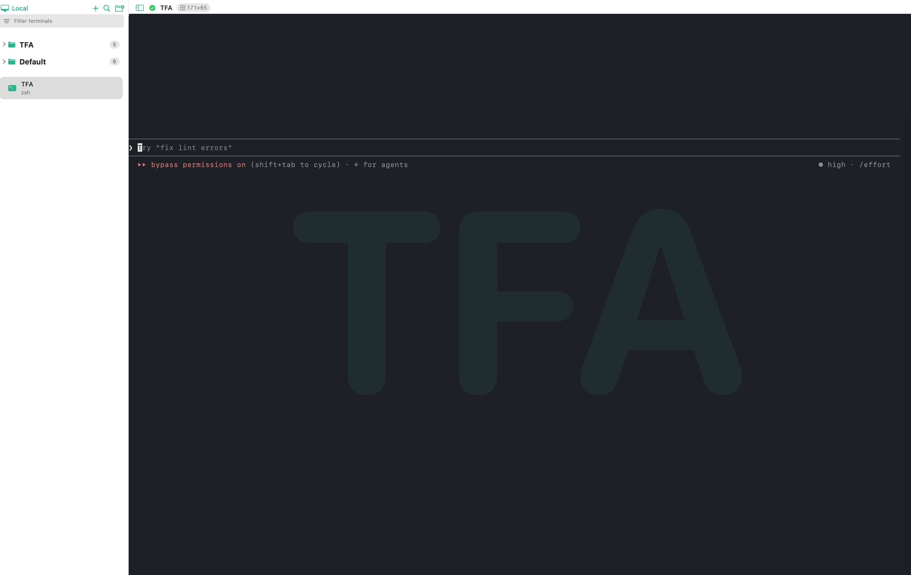

# TFA — 可视化的 tmux 终端管理器（macOS）

> TFA（Terminal For AI）是一个原生 macOS 应用：在一个窗口里管理大量本地与远程终端，断线不丢、随时重连。
> 底层是真实的 tmux（控制模式 `tmux -CC`），TFA 只做可视化与管理。



## 📦 安装

[**下载最新版 TFA.app**](https://github.com/wstart/TFA/releases/latest)，解压后拖入「应用程序」，双击打开。

- 系统：macOS 14+，仅 Apple Silicon（M 系列）。
- 依赖：`brew install tmux`（没装时 App 会提示）。
- 已签名并经 Apple 公证；在设置（⌘,）里可一键检查更新。

## ✨ 核心特性

- **一个终端 = 一个 tmux 会话**：退出 App 只 detach，会话保留，下次启动恢复。
- **断线不丢**：SSH 抖动、管道中断后自动重连；tmux 服务器崩溃或重启电脑后，可从「已断开」一键恢复会话和屏幕历史，AI 终端自动续接对话。
- **管理大量终端**：侧栏实时显示每个终端是否在输出；⌘K 快速切换，⌘F 跨终端搜索，⌘] 跳到需要你的终端；可拖拽分组。
- **本地 + SSH 远程**：支持密码、主机指纹、2FA 等交互式登录。
- **主管 + 工单**：用自然语言提需求，主管派给执行终端去做（改代码的工单用独立 git worktree），只在需要你时通知。
- **AI 工具箱**：项目工作区、Claude Code / Codex 规则与 Skills 编辑、本地模型 axis-model 与命令行助手 axis-claude、SSH 反向隧道与 Cloudflare 公网隧道、Token 用量统计。

完整说明见 [docs/features.md](docs/features.md)。

## 🤖 主管 + 工单

参考 DeepSeek 开源的 [Super-agent 原型](https://github.com/deepseek-ai/dsh-superagent-prototype)（MIT）。

1. 在侧栏顶部的「主管」终端里提需求。主管只负责派单，不读代码、不改文件。
2. 主管按角色接单：「助理」做问答和调研；「开发」每单一个终端和独立 git worktree（分支 `tfa/<号>`）。
3. 执行者只在**待评审、要你回答、受阻、失败**时通知你。
4. 点「通过」把工单分支合并进主仓库当前分支并结单；点「打回」或「回答」把你的话送回执行终端。

原理见 [docs/superagent-design.md](docs/superagent-design.md)，角色见 [docs/superagent-roles.md](docs/superagent-roles.md)。

## ⌨️ 快捷键

| 键 | 作用 | | 键 | 作用 |
|---|---|---|---|---|
| ⌘T | 新建终端 | | ⌘F | 跨终端搜索 |
| ⌘W | 关闭（detach，会话保活） | | ⌘K | 快速切换面板 |
| ⌘1–9 | 选第 N 个终端 | | ⌘] | 跳到下一个需要你的终端（待处理优先） |
| ⌘⌥← / → | 上一个 / 下一个终端 | | ⌘⇧] | 跳到下一个待处理（等待 / 受阻）终端 |
| ⌘\ | 折叠 / 展开侧边栏 | | | |
| ⌘ + / − / 0 | 字号 增 / 减 / 重置 | | ⌘, | 设置（含快捷键速查） |
| ⌘S | 编辑器内保存（CLAUDE.md / SKILL.md） | | ⌘R | 失败态重试连接 |

## 🛠 从源码构建

```sh
swift build                      # 编译全部（含 app）
swift run Mux                    # 开发跑（SwiftPM target 仍叫 Mux）

# 打包成可双击的 TFA.app（改完代码务必重打包再测，否则 open 的是旧包）：
./scripts/build-app.sh release
codesign --force --deep --sign - TFA.app
open TFA.app
```

> **依赖**：本机已安装 `tmux`（控制模式必需）。远程功能依赖系统 `ssh` 与你既有的 SSH 配置 / 密钥。
> 工具链：Swift 6，各 target `.swiftLanguageMode(.v5)`，SwiftTerm 1.13.0（仅 app）。

## 📚 文档

- [`docs/features.md`](docs/features.md) — 完整功能说明
- [`CHANGELOG.md`](CHANGELOG.md) — 版本变更记录
- [`docs/architecture.md`](docs/architecture.md) — 架构、关键难点、目录结构、技术要点
- [`DESIGN.md`](DESIGN.md) — 设计系统（token、状态模型、组件、终端主题）
- [`docs/tmux-control-protocol.md`](docs/tmux-control-protocol.md) — tmux 控制协议规格
- [`docs/swiftterm-integration.md`](docs/swiftterm-integration.md) — SwiftTerm 集成规格

## 📄 License

[Apache License 2.0](LICENSE) © wstart.
